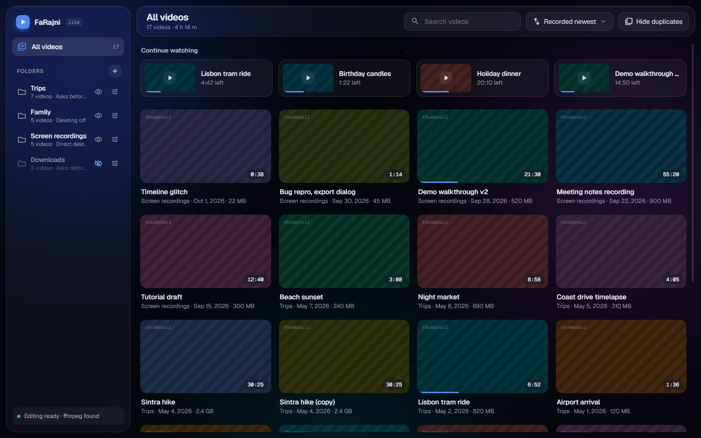
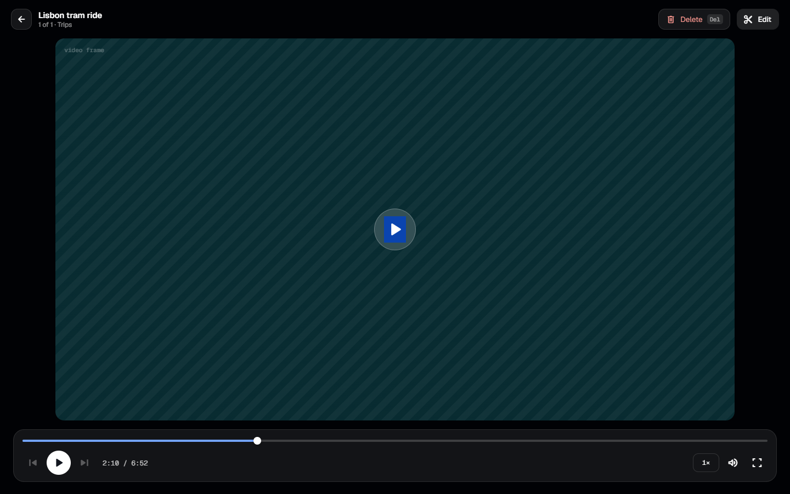
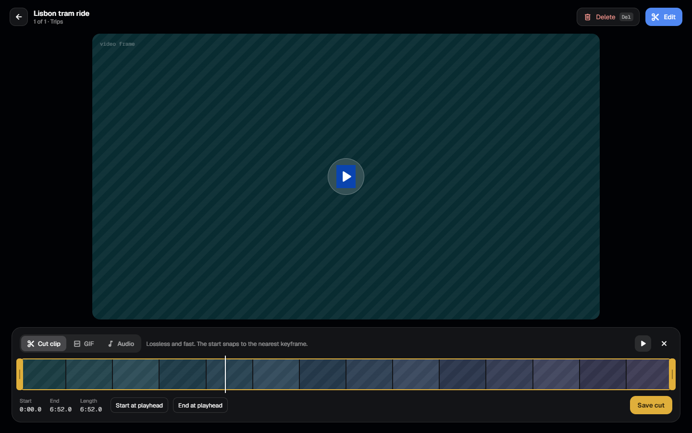

<p align="center">
  
</p>

<p align="center">
  <a href="https://github.com/iDaf3k/FaRajni/releases/latest"></a>
  <a href="https://github.com/iDaf3k/FaRajni/releases/latest"></a>
  
  
  <a href="LICENSE"></a>
</p>

<p align="center">
  <b>FaRajni</b> turns the folders of videos on your PC into a browsable library,
  plays them instantly, and lets you trim, convert and tidy them up without opening another app.
</p>

<p align="center">
  <a href="https://github.com/iDaf3k/FaRajni/releases/latest/download/FaRajni-Setup-1.0.3.exe">
    
  </a>
</p>

<p align="center">
  <a href="#-download">Download</a> ·
  <a href="#-features">Features</a> ·
  <a href="#-screenshots">Screenshots</a> ·
  <a href="#%EF%B8%8F-keyboard-shortcuts">Shortcuts</a> ·
  <a href="#-build-from-source">Build from source</a> ·
  <a href="docs/ARCHITECTURE.md">Architecture</a>
</p>

---

## ⬇️ Download

| | File | |
|---|---|---|
| 🪟 **Installer** (recommended) | `FaRajni-Setup-1.0.3.exe` · ~70 MB | [**Download**](https://github.com/iDaf3k/FaRajni/releases/latest/download/FaRajni-Setup-1.0.3.exe) |
| 📦 **Source code** | `.zip` | [Download](https://github.com/iDaf3k/FaRajni/archive/refs/tags/v1.0.3.zip) |
| 📦 **Source code** | `.tar.gz` | [Download](https://github.com/iDaf3k/FaRajni/archive/refs/tags/v1.0.3.tar.gz) |

All versions are on the **[Releases page](https://github.com/iDaf3k/FaRajni/releases)**.

**Installing:** run the installer and follow the steps. No .NET install is needed. During setup you can
make FaRajni your default video player and add a desktop shortcut.

> Windows SmartScreen may warn about an unrecognised app because the installer isn’t code-signed.
> Click **More info → Run anyway**.

## ✨ Features

<table>
<tr>
<td width="50%" valign="top">

### 📚 Library
- **Watch folders**: add any folder, and FaRajni finds every video inside it, subfolders included.
- **Continue watching** picks up exactly where you stopped.
- **Search and sort** by name, date added, date recorded or length.
- **Hide duplicates**: files with the same size and duration show up once.
- **Per-folder settings**: hide a folder from *All videos*, or remove it from the library. The files stay on disk.
- **Fast thumbnails** come from Windows Explorer’s own thumbnail cache.

</td>
<td width="50%" valign="top">

### ▶️ Player
- **Instant start**: one VLC engine, created in the background and reused for every video.
- **Plays practically anything** (mp4, mkv, avi, mov, webm, ts, …) through **libVLC**.
- **Full controls**: resume, previous/next, speed, mute, fullscreen, all from the keyboard.
- **Opens from Explorer**: double-clicking a video plays it, with its folder as the playlist
  in natural order (`2` before `10`).
- **Single window**: opening more files reuses the window that's already open.

</td>
</tr>
<tr>
<td width="50%" valign="top">

### ✂️ Editor
- **Cut**: lossless trim; the start snaps to the nearest keyframe.
- **GIF**: export any range as a high-quality GIF.
- **Audio**: save the soundtrack as MP3.
- **Merge**: join several videos. Lossless when possible, re-encoded when the codecs differ.
- The editor uses **ffmpeg**, which isn't bundled. FaRajni uses an installed copy, or downloads it in one click.

</td>
<td width="50%" valign="top">

### 🗑️ Safe deleting
Each folder has its own **delete mode**:

| Mode | What <kbd>Del</kbd> does |
|---|---|
| **Off** | Nothing: the folder is protected |
| **Ask first** *(default)* | Asks, then moves to the Recycle Bin |
| **Direct** | Recycle Bin right away, with a 5-second **Undo** |

Files always go to the Recycle Bin. FaRajni never deletes anything permanently.

</td>
</tr>
</table>

## 📸 Screenshots

> These come from the design preview, filled with demo videos.

<p align="center">
  
</p>

<table>
<tr>
<td width="50%"></td>
<td width="50%"></td>
</tr>
<tr>
<td align="center"><sub><b>Player</b>: minimal on-screen controls, everything on the keyboard</sub></td>
<td align="center"><sub><b>Editor</b>: cut, GIF and audio on a filmstrip timeline</sub></td>
</tr>
</table>

## ⌨️ Keyboard shortcuts

| Key | Action | | Key | Action |
|---|---|---|---|---|
| <kbd>Space</kbd> / <kbd>K</kbd> | Play / pause | | <kbd>↑</kbd> / <kbd>↓</kbd> | Volume ±5 |
| <kbd>→</kbd> / <kbd>L</kbd> | Forward 10 s | | <kbd>M</kbd> | Mute |
| <kbd>←</kbd> / <kbd>J</kbd> | Back 10 s | | <kbd>F</kbd> | Fullscreen |
| <kbd>N</kbd> / <kbd>PgDn</kbd> / <kbd>Shift</kbd>+<kbd>→</kbd> | Next video | | <kbd>E</kbd> | Open / close editor |
| <kbd>P</kbd> / <kbd>PgUp</kbd> / <kbd>Shift</kbd>+<kbd>←</kbd> | Previous video | | <kbd>Del</kbd> | Delete (per folder mode) |
| Media keys | Play/pause, next, previous | | <kbd>Esc</kbd> | Leave fullscreen / back |

## 🛠 Build from source

**Requirements:** Windows 10/11 x64 and the [.NET 8 SDK](https://dotnet.microsoft.com/download/dotnet/8.0).

```powershell
git clone https://github.com/iDaf3k/FaRajni.git
cd FaRajni
dotnet run --project src/FaRajni.App
```

Release builds and details: **[docs/BUILDING.md](docs/BUILDING.md)**.

### Project structure

```
src/
├── FaRajni.Core     .NET 8 library: models, SQLite catalog, folder scanner, library query,
│                    delete policy, legacy import, ffmpeg wrappers (no UI)
├── FaRajni.App      WPF app: theme, library, player (LibVLCSharp), dialogs, thumbnails
└── FaRajni.Editor   WPF library: edit panel and merge dialog, loaded only when first used
```

Why it starts fast, how data is stored, and how the parts fit together:
**[docs/ARCHITECTURE.md](docs/ARCHITECTURE.md)**.

## 🔒 Privacy

FaRajni works completely offline. There are no accounts, no telemetry and no cloud. It only reads the
folders you add. Its catalog, settings and thumbnails live in `%LocalAppData%\FaRajni`. The only
network request it ever makes is the optional ffmpeg download, and only when you ask for it.

## 🙏 Built with

[libVLC / LibVLCSharp](https://code.videolan.org/videolan/LibVLCSharp) (LGPL-2.1) ·
[Microsoft.Data.Sqlite](https://github.com/dotnet/efcore) (MIT) ·
[VirtualizingWrapPanel](https://github.com/sbaeumlisberger/VirtualizingWrapPanel) (MIT) ·
[Geist font](https://github.com/vercel/geist-font) (SIL OFL 1.1) ·
[FFmpeg](https://ffmpeg.org) (downloaded on request, not bundled)

## 📄 License

FaRajni is released under the **[MIT License](LICENSE)**.
