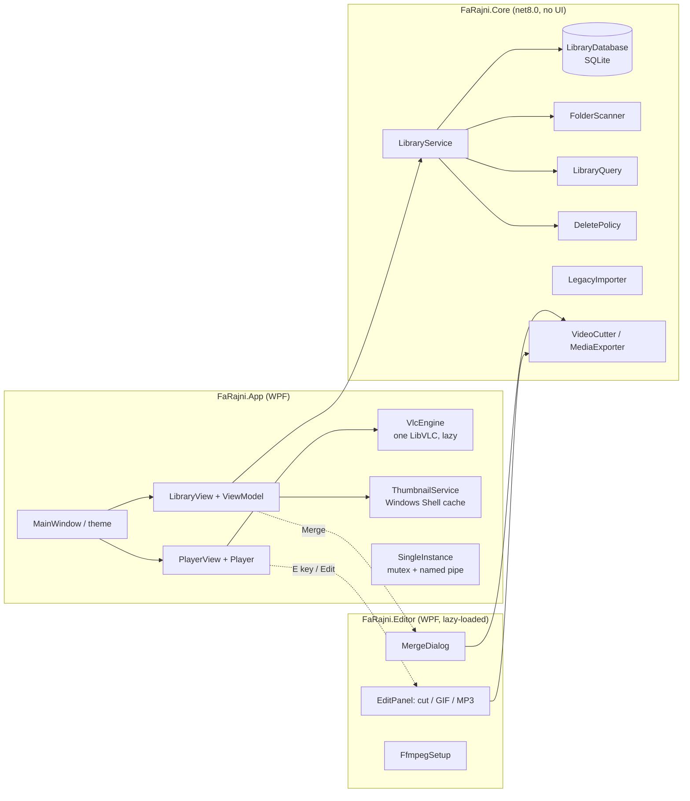

# Architecture

FaRajni is a small, three-project .NET 8 solution. The guiding rule: **nothing that isn’t needed to
show the window and start a video runs before the window is on screen.**



## Projects

| Project | Target | Responsibility |
|---|---|---|
| `FaRajni.Core` | `net8.0` | Models, SQLite catalog, folder scanning, library query (filter/search/sort/dedupe), delete policy, legacy import, ffmpeg wrappers. No UI references. |
| `FaRajni.App` | `net8.0-windows` (WPF) | Window, night theme, library grid, player, dialogs, Explorer integration, thumbnails, VLC hosting. |
| `FaRajni.Editor` | `net8.0-windows` (WPF library) | Edit panel (cut / GIF / audio), merge dialog, ffmpeg download. Nothing on the startup path touches its types, so the CLR only loads this assembly the first time you edit. |

## Startup performance

| Technique | Where |
|---|---|
| A single `LibVLC` instance is created on a background thread **after first paint**; the player awaits it. | `Services/VlcEngine.cs` |
| One `MediaPlayer` and one player view are **reused** for every video; the library view stays alive behind it. | `Services/Player.cs`, `Views/PlayerView` |
| VLC plugin cache can be pre-built once (`FaRajni.exe --build-vlc-cache`), so libVLC skips scanning ~300 plugin DLLs. | `VlcEngine.cs` |
| Only the VLC plugin groups a local player needs are shipped (no streaming-out, Lua, visualizations…). | `FaRajni.App.csproj` |
| `:file-caching=300` per media instead of VLC’s default 1000 ms. | `Services/Player.cs` |
| Thumbnails come from Windows’ own thumbnail cache (`IShellItemImageFactory`), not from decoding video. | `Interop/ShellMedia.cs`, `Services/ThumbnailService.cs` |
| Tiered PGO; ReadyToRun recommended for release builds. | csproj |
| Editor assembly lazy-loaded. | `Services/EditorBridge.cs` |

## Data

Everything lives in `%LocalAppData%\FaRajni\`:

| File | Contents |
|---|---|
| `library.db` | SQLite catalog |
| `settings.json` | UI settings (sort, tile size, volume, hide duplicates) |
| `thumbnails\` | Cached JPEG thumbnails |
| `tools\ffmpeg.exe` | ffmpeg, if downloaded through the app |
| `crash.log` | Unhandled exceptions (the app never crashes on a file or ffmpeg error; it shows a message) |

### Schema

```sql
folders(id, path UNIQUE, name, hidden, delete_mode, date_added)
videos (id, folder_id → folders ON DELETE CASCADE, file_path UNIQUE, title,
        duration_ms, file_size, date_added, file_modified, thumbnail_path,
        resume_ms, last_played)
```

Removing a folder deletes its rows (cascade) — never the files on disk.

## Library query

`LibraryQuery` is a pure function from *(videos, folders, options)* to the list shown:

- **Folder filter** — hidden folders are excluded from *All videos*, *Continue watching* and search,
  but you can still open them directly.
- **Search** — case-insensitive match on title.
- **Hide duplicates** — videos with the same file size **and** duration collapse into one.
- **Sort** — Name, Recently added, Recorded newest, Recorded oldest, Longest.

## Delete policy

`DeletePolicy.Decide(videos, folders)` returns one of:

- `Blocked` — every selected video is in a folder whose mode is **Off**.
- `Confirm` — at least one is in an **Ask first** folder.
- `Direct` — all are in **Direct** folders.

It also reports how many videos were skipped. Direct deletes are staged: the tile disappears at once,
and the file is sent to the Recycle Bin when the Undo toast expires (or on exit). Ticking
*“Don’t ask again”* switches the affected folders to **Direct**.

## Opening files from Explorer

`DefaultPlayerRegistration` registers a ProgId and file-type associations for the current user, then
opens *Settings → Default apps* so you can pick FaRajni. When a video is opened:

1. `SingleInstance` grabs a per-user mutex. If another FaRajni is already running, the new process
   sends the path over a named pipe and exits.
2. The running instance plays the file and builds a playlist from **its folder**, sorted with
   `NaturalOrder` (`clip 2` before `clip 10`).

## Editor & ffmpeg

ffmpeg is not bundled (it would double the download). `FfmpegLocator` looks in
`%LocalAppData%\FaRajni\tools`, then `PATH`, then the WinGet links shim. If none is found the editor
offers a one-time download of the gyan.dev *essentials* build, extracting only `ffmpeg.exe`.

| Operation | Implementation |
|---|---|
| Cut | Stream copy (`-c copy`) — lossless and fast; start snaps to the nearest keyframe. |
| GIF | `palettegen` + `paletteuse` in one filter graph for good colour. |
| Audio | Extract to MP3. |
| Merge | Concat demuxer with stream copy; falls back to re-encode if codecs differ. |

Output files are written next to the source (`name - cut.mp4`, `name (2).gif`, …) — originals are
never modified. The filmstrip on the timeline is extracted by ffmpeg only while the panel is open,
and cancelled when it closes.

## Theme

The “Night” theme (`Theme/Night.xaml`) uses translucent fills and hairline borders over soft radial
glows — a glass look without live blur, which WPF can’t do cheaply. Typeface is **Geist** (bundled,
SIL OFL); icons are **Segoe Fluent Icons**, built into Windows 11, so they add zero bytes. The
title bar is darkened through DWM (`Interop/Dwm.cs`).

## Legacy import

On first run with an empty library, `LegacyImporter` looks for a catalog from FaRajni’s predecessor
apps and copies folders, videos, resume points and thumbnails. The old database is opened read-only
and never modified.
